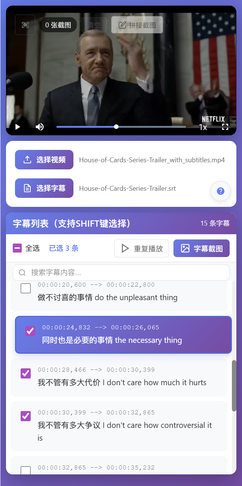
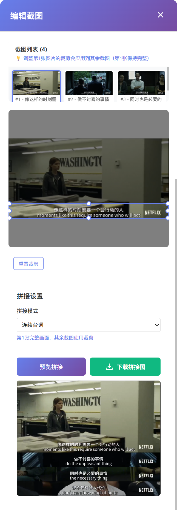
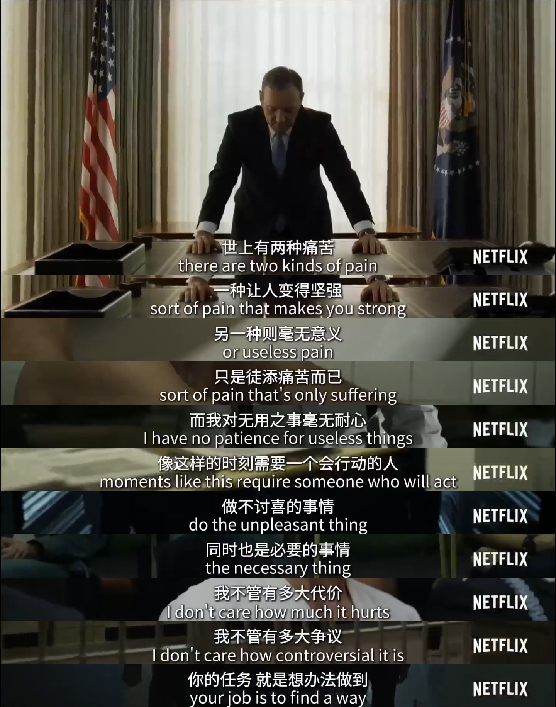

# Vibo Player 美剧精听播放器 电影台词批量截图神器

### 记住上次播放

- 重新打开网页时恢复最近一次的视频、字幕、进度、倍速、音量、静音、单句模式、字幕显示模式、遮罩高度和已勾选字幕，恢复后保持暂停，点击播放继续。循环播放和截图编辑结果不恢复。
- 在支持文件授权的 Chrome/Edge 中，通过“选择视频”打开文件后，网页会在本地保存文件访问句柄，不复制或上传视频。再次打开时若浏览器需要授权，点击“恢复上次播放”即可。
- 通过普通文件选择、拖放导入，或浏览器不支持文件授权时，重开后需重新选择原视频；文件名、大小和修改时间一致时恢复字幕及进度。原文件移动、删除或被修改后可能需要重新选择。
- 进度每两秒保存一次，并在暂停、拖动结束、切换视频或页面隐藏时补存。突然断电或进程崩溃时，最后约两秒的进度可能来不及保存。批量截图的临时跳转不会覆盖观看位置。
- “清除播放记录”只清除本功能保存的数据，不删除原文件或布局宽度设置；当前视频不再记录，下次选择视频重新开始记录。
- 记录仅属于当前浏览器的当前网站地址，不跨设备同步。清除站点数据、隐私模式退出或浏览器回收存储后可能丢失。存储不可用时会提示，正常播放不受影响。文件授权需 HTTPS 或 localhost 环境。

开发验证：安装 Node.js 后运行 `npm install`、`npm test`；安装 Chrome 和 Edge 后运行 `npm run test:browser`。浏览器测试使用独立临时配置目录，实际关闭并重新启动浏览器验证持久化；文件句柄序列化通过真实 OPFS 句柄测试，授权拒绝和文件失效通过接口模拟测试，不操作个人浏览器资料。

> 🔗 **体验地址**: [vibplayer.stevenpub.com](https://vibplayer.stevenpub.com)

支持复读、慢速播放、字幕遮蔽，多语种切换、字幕搜索、台词批量截图等功能，基于字幕批量生成视频截图并智能拼接成台词海报，支持选定字幕片段自动重复播放，便于学习和复习。纯前端网页，所有数据处理均在本地完成，无需上传服务器

## 🖥️ 界面预览

### 主界面

### 截图编辑界面

## 📸 台词截图效果

## ✨ 核心功能

### 🕶️ 字幕遮蔽（无字幕看美剧）

- **无字幕训练**：通过可拖拽遮罩隐藏字幕区域，只听声音练习；在需要核对时再打开遮罩，完成从“依赖字幕”到“无字幕看美剧”的过渡训练

### 🔤 中英字幕切换

- **字幕语言模式切换**：支持双语、仅英文、仅中文字幕等模式一键切换；也可切换到“隐藏字幕（仅隐藏字幕文字）”，用于听感核对/听前猜等不同学习阶段（不等同于遮罩拖拽训练）

### 📸 智能截图系统（核心亮点）

- **批量截图**：选择多条字幕，一键批量截图
- **精准定位**：自动跳转到字幕对应的视频时间点截图
- **Shift连选**：支持Shift键快速选择连续多条字幕
- **智能搜索**：关键词搜索字幕，快速定位要截取的内容

### 🖼️ 手动精确截图(无字幕文件时)

- **手工截图**：播放暂停时，可对视频截图，多次截取一次拼图

### ▶️ 选定字幕重复播放

- **AB复读**：勾选多行台词，自动复读

### ✂️ 专业截图编辑器

- **可视化裁剪**：8个控制点精确调整裁剪区域
- **两种拼接模式**：
  - 🎬 **连续台词**：第一张完整画面，其余裁剪字幕区域（适合对话场景）
  - 🎞️ **连续画面**：所有截图使用统一裁剪（适合连续镜头）
- **自动裁剪应用**：调整第一张图片的裁剪，自动应用到后续截图
- **截图管理**：
  - 上移/下移调整顺序
  - 替换图片（支持导入外部图片）
  - 删除不需要的截图
  - 实时预览裁剪效果

### 🎨 灵活的拼接选项

- **自定义间距**：调整图片之间的间距（0-50px）
- **边距控制**：设置整体边距（0-50px）
- **背景颜色**：白色、黑色、灰色、紫色多种选择
- **原始尺寸输出**：保持视频原始分辨率，无损画质
- **实时预览**：拼接前预览最终效果
- **一键下载**：导出为PNG格式高清图片

### 适用场景

- 📚 **制作学习笔记**：截取教学视频的重点内容
- 🎬 **电影台词收集**：保存经典台词画面
- 📝 **视频总结**：快速生成视频内容概览
- 💬 **对话记录**：整理采访或对话内容
- 🎨 **素材收集**：为创作收集视频素材

## 📖 使用说明

### 快速开始截图

1. **加载视频和字幕**
   - 点击"选择视频"按钮选择视频文件
   - 点击"选择字幕"按钮选择 .srt 字幕文件
   - 或直接拖放视频和字幕文件到播放区域

2. **选择要截图的字幕**
   - 在右侧字幕列表中勾选需要截图的字幕
   - 💡 使用**Shift键**快速选择连续多条字幕
   - 💡 使用**搜索框**快速定位关键台词
   - 💡 点击**全选**勾选所有字幕（最多100条）

3. **生成截图**
   - 点击"生成截图"按钮
   - 系统会自动跳转到每条字幕的时间点进行截图
   - 等待截图完成（进度显示在按钮上）

4. **预览和下载**
   - 点击"预览拼接"查看最终效果
   - 满意后点击"下载拼接图"保存到本地

### 其他功能

- **字幕导航**：点击字幕跳转到对应视频时间点
- **字幕搜索**：输入关键词快速查找字幕
- **视频播放**：支持倍速播放和键盘快捷键控制
- **中英字幕切换**：在播放器中切换双语、仅英文、仅中文字幕以及“隐藏字幕（仅隐藏字幕文字）”
- **字幕遮蔽**：通过可拖拽遮罩隐藏字幕，用于“先听后看”的训练（实现无字幕看美剧）

### 键盘快捷键

| 快捷键 | 功能 |
|--------|------|
| `空格` | 播放/暂停 |
| `←` | 后退 5 秒 |
| `→` | 前进 5 秒 |
| `↑` | 跳转到上一条字幕 |
| `↓` | 跳转到下一条字幕 |

### 支持的格式

- **视频格式**：MP4、WebM、Ogg、MKV 等
  - 注意：MKV 格式支持取决于浏览器和视频编码格式
  - 推荐使用 Chrome/Edge 浏览器以获得更好的 MKV 支持
- **字幕格式**：SRT（SubRip Text）

## 📋 字幕文件格式

项目支持标准的 SRT 字幕格式：

## 🎬 视频格式兼容性

### 推荐格式（完美兼容）

| 容器 | 视频编码 | 音频编码 | 兼容性 |
|------|---------|---------|--------|
| MP4 | H.264 | AAC/MP3 | ✅✅✅ 最佳 |
| WebM | VP8/VP9 | Opus/Vorbis | ✅✅ 很好 |

### 需要转换的格式

| 容器 | 音频编码 | 问题 | 解决方案 |
|------|---------|------|---------|
| MKV | AC3/DTS | ❌ 浏览器不支持 | 转换为 MP4|
| MOV | ALAC | ⚠️ 部分不支持 | 转换音频为 AAC |

## 🤝 贡献

欢迎提交 Issue 和 Pull Request！

## 📄 许可证

MIT License

---

如有任何问题或建议，请提交 Issue。祝使用愉快！ 🎉

